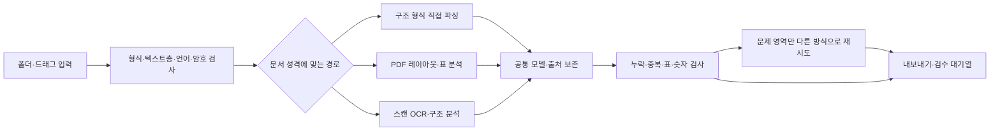

# 범용 정보·문서 → Markdown → AI·Wiki: 조사와 확장 계획

조사일: 2026-10-23 · 대상: 기존 PDF Extractor / PubNexus · 상태: 구현 전 제안

> **최신 범위:** 이 문서는 초기 조사 후보를 보존한 자료입니다. 이후 사용자 피드백으로 LLM/API 배제, 기존 PDF 논문 경로 유지, rHWP 직접 사용, 파일/폴더 선택과 간단한 경고 목록으로 범위를 좁혔습니다. 구현은 [최신 간소화안](./2026-10-23-simplified-scope.md)을 우선합니다. 아래의 감시 폴더·자동 개정판·셀별 원본 이동·클라우드 후보는 초기 구현 요구가 아닙니다.

이번 작업은 기존 코드와 공식 자료를 읽고 계획을 세운 것입니다. 변환 엔진 설치, 실문서 변환, 외부 문서 업로드, 기존 코드·PRD 변경은 하지 않았습니다. 첨부 화면은 결함의 관찰 근거이며, 해당 PDF의 정본·TEI·실행 로그를 확인한 재현 결과는 아닙니다. 기존 생성물 이동도 사용자의 선택에 따라 이번 범위에서 제외했습니다.

## 1. 권고안

**기존 논문 추출기를 보존하면서, 형식별 추출기와 공통 문서 모델을 추가하는 것이 적합합니다.** PDF 표 문제를 먼저 비교 측정하고, DOCX/PPTX/XLSX/HWPX/HWP를 순차적으로 연결합니다.

사용자의 최종 목표는 문서 변환 자체를 넘어 **어떤 정보든 출처가 있는 Markdown 자료로 모아 AI에게 읽히거나 위키로 구성하기 쉽게 만드는 것**입니다. 논문 전용 수리가 공통 흐름을 지배하지 않게 하고, 책 한 권 분량의 PDF도 실패 후 이어서 처리할 수 있는 안정성을 핵심 요구로 둡니다.

핵심 결정은 다음과 같습니다.

1. **파일 안에 구조가 있으면 먼저 그 구조를 읽습니다.** Word의 표·목록, Excel의 셀·수식, HWPX의 문단·표를 모두 PDF나 이미지로 바꾼 뒤 재인식하지 않습니다.
2. **PDF·스캔은 레이아웃과 표 구조를 복원합니다.** 텍스트를 많이 뽑는 것과 표를 정확하게 뽑는 것을 별도 목표로 둡니다.
3. **JSON을 정본으로 유지하고 MD를 정식으로 내보냅니다.** 기존 PRD의 단일 정본 원칙을 유지하면서 사용자가 원하는 `.md` 파일을 생성합니다. MD에는 정본 revision을 기록하고, 다시 내보낼 때 갱신 여부를 알립니다.
4. **표·그림·수식·각주·읽기 순서를 보존 범위로 선언합니다.** 글꼴·페이지 꾸밈의 완전 복제는 별도 목표입니다.
5. **자동 재시도와 검수 대기열을 함께 만듭니다.** 추출 성공과 검수 통과를 다른 상태로 표시합니다.

Docling을 공통 엔진의 **첫 시험 후보**, PaddleOCR 계열을 스캔·표의 **독립 비교 후보**, 기존 PubNexus를 **논문 프로필**로 두는 구성을 권합니다. 이는 본 프로젝트 문서로 성능 검증을 끝낸 최종 선정이 아닙니다. [Docling 공식 개요](https://github.com/docling-project/docling), [PaddleOCR 공식 저장소](https://github.com/PaddlePaddle/PaddleOCR)

## 2. 지원 범위: 확장자보다 문서의 성격까지 구분

아래는 지원 목표입니다. 표의 단계는 개발 순서이며, 현재 앱에서 이미 지원한다는 뜻이 아닙니다.

| 단계 | 문서군과 형식 | 우선 경로 | 보존·검수의 핵심 |
|---|---|---|---|
| 1 | 일반·논문·보고서·공문 PDF | 페이지별 텍스트층 검사 → 레이아웃/표 모델 | 2단 읽기 순서, 무테두리 표, 합본 문서 경계 |
| 1 | 스캔 PDF, 사진 문서 PNG/JPG/TIFF/WEBP | 방향·기울기 보정 → 한국어/영어 OCR → 구조 복원 | 저해상도, 한영 혼합, 숫자/단위, 다중 페이지 TIFF |
| 2 | Word DOCX/DOTX, OpenDocument ODT | Docling 또는 구조 파서, Pandoc 비교 | 제목·목록·표·병합·각주·수식·이미지·주석 |
| 2 | PowerPoint PPTX/POTX, ODP | 슬라이드 구조 파서 → 읽기 순서 조정 | 도형·그룹·표·발표자 노트, 차트·SmartArt의 이미지 보존 |
| 2 | Excel XLSX, ODS, CSV/TSV | 시트·셀 구조 추출 + 값/수식 별도 읽기 | 시트명, 병합셀, 다중 표, 수식 원문과 계산 캐시 |
| 3 | 한글 HWPX | ZIP/XML 직접 파싱 | 문단·표·병합·섹션 순서·각주·그림·수식 |
| 3 | 한글 HWP 5.x | OLE/레코드 파서 → 검증된 변환 경로 | 표의 실제 셀 좌표, 인코딩·그림·수식, 배포 의존성 |
| 4 | 구형 Office DOC/PPT/XLS, RTF | LibreOffice로 DOCX/PPTX/XLSX 등 구조 형식 변환 | 변환 전후 누락·레이아웃 차이, 설치 크기 |
| 4 | HTML/HTM, MHTML/MHT, EPUB | DOM/본문·표 추출, 장·링크·자산 보존 | 본문과 메뉴 구분, 원래 읽기 순서 |
| 4 | EML/MSG | 메일 헤더·본문·첨부 구조 추출 | 스레드 중복, 인라인 이미지, 첨부의 명시적 재귀 처리 |
| 4 | JATS/TEI 등 명세가 알려진 XML | 스키마별 구조 파서 | 문서 계층·인용·표·수식. 임의 XML에는 별도 규칙 필요 |
| 4 | TXT/MD/RST/AsciiDoc/LaTeX/IPYNB | 인코딩·마크업 파서 | 코드/수식 보존, include 범위 제한, 코드 실행 금지 |
| 후속 | Pages/Numbers/Keynote | 공통 엔진의 해당 backend 또는 원 앱 내보내기 | 컨테이너 세대·암호·차트·수식별 검증 |
| 별도 | 오래된 HWP, HWT/HWPML, OneNote, CAD/Visio, 양식·설계 도면 | 실제 수요와 표본 확보 후 전용 어댑터 | 인식 가능과 충실한 변환 가능을 구분 |

Docling의 현재 공식 지원 목록에는 Office·ODF·웹·전자책·메일·일부 XML·iWork 등이 포함됩니다. 구형 Office와 RTF는 LibreOffice 의존성이 명시돼 있습니다. 실제 배포 버전의 입력 목록과 backend 동작을 고정해서 확인해야 합니다. [공식 지원 형식](https://github.com/docling-project/docling/blob/main/docs/usage/supported_formats.md)

DOCM/PPTM/XLSM 같은 매크로 포함 형식은 안전한 정적 읽기를 확인한 뒤 별도 표시합니다. ZIP은 문서 형식 자체가 아니라 여러 입력을 묶는 컨테이너로 취급합니다. 오디오·동영상 전사는 추가할 수 있지만, 문서 추출 MVP와 별도 기능으로 둡니다.

확장자별로 `식별 가능 / 추출 가능 / 보존 범위 검증 완료`를 구분한 지원표를 앱에 제공합니다. 암호화·손상·미지원 파일을 조용히 일반 텍스트로 바꾸지 않습니다.

## 3. 현재 첨부 화면과 코드에서 확인된 문제

### 코드로 확인한 사실

| 관찰 | 코드 근거 | 의미 |
|---|---|---|
| 표 경고는 `tables[].markdown`이 비었을 때 표시 | `render.py:52` | 화면에 보이는 경고만으로 UI 렌더링 오류라고 판단할 수 없음 |
| 단건 추출에도 `tablefill`은 연결되어 있음 | `single.py:327` | 과거 누락 주석을 지금 원인으로 쓰면 안 됨 |
| 표 영역 탐지 성공 때만 표 본문 줄을 본문 후보에서 제외 | `pdf_fallback.py:924` | 영역 탐지 실패 시 캡션은 표에, 수치는 본문에 남을 수 있음 |
| 후행 `tablefill`은 표 목록을 수리하지만 본문 수치 잔재를 제거하지 않음 | `tablefill.py:1793` | 뒤에서 표 하나를 추가하는 것만으로 중복·혼입이 해결되지 않음 |
| 표 복원은 캡션·벡터 괘선에 크게 의존하며 `no_rules` 실패 경로가 있음 | `tablefill.py:1307` | 무테두리·이미지 표를 포괄하는 경로가 필요 |
| 표별 실패 상세가 반환돼도 단건 정본에는 충분히 보존되지 않음 | `single.py:332` | 왜 실패했는지 사용자와 개발자가 알기 어려움 |
| 품질 점수가 표 셀 정확성·본문 혼입을 직접 평가하지 않음 | `qc.py:42` | 기존 종합 점수를 범용 품질 보장으로 재사용할 수 없음 |
| 현재 경로에는 한글 비율 15% 초과 시 본문을 비우는 정책이 있음 | `single.py:360` | 한국어 일반 문서를 기존 논문 경로에 바로 넣으면 안 됨 |
| 정본의 Table은 Markdown 중심이며 셀·병합·출처 위치 계약이 부족 | `schema.py:24` | 범용 중간 모델이 필요 |
| 정본/TEI 캐시 판정에 엔진·설정 버전이 충분히 포함되지 않음 | `store.py:109`, `single.py:78` | 엔진을 바꿔도 과거 결과를 재사용할 수 있음 |

파일 기준 디렉터리: `pubnexus/src/pubnexus/`. 앱 경로는 `pubnexus/app.py`입니다.

### 아직 확정하지 못한 것

선택 문서가 PyMuPDF 폴백이었는지, GROBID가 표를 문단으로 분류했는지, 캡션/괘선 검사에서 거절됐는지, 과거 캐시를 표시한 것인지는 재현이 필요합니다. 특정 원인을 확정하려면 **동일 PDF + 저장된 정본 + TEI/레이아웃 결과 + 엔진 정보**를 함께 비교해야 합니다. 이번에는 이 실제 자료를 읽거나 재추출하지 않았습니다.

PRD에 적힌 203편 품질·속도·누락 수치는 2026-07-26 기록입니다. 이번 실행의 측정값으로 인용하지 않습니다.

## 4. 엔진·알고리즘 선택

| 역할 | 첫 후보 | 보완·비교 후보 | 선정 이유와 제약 |
|---|---|---|---|
| 공통 구조 문서 변환 | Docling | Pandoc / MarkItDown | 공통 문서 모델을 활용하고 형식별 결손만 보완. 단일 도구의 지원 목록이 품질 보증은 아님 |
| PDF 레이아웃·표 | Docling PDF pipeline | PaddleOCR 구조 분석, MinerU/Marker 비교 | 영역·읽기 순서·셀 구조를 함께 복원. 한국어·Windows·모델 라이선스는 별도 gate |
| 스캔·사진 OCR | 한국어 지원을 확인한 PaddleOCR/OCR backend | Docling의 OCR backend 비교 | 문자·방향·구조 성능을 따로 측정. 엔진 이름만으로 한국어 정확성을 보장하지 않음 |
| 텍스트 PDF의 표 영역 재시도 | pdfplumber/Camelot | 다른 표 구조 모델 | 괘선/간격/좌표 기반 알고리즘을 특정 영역에 적용. 버전별 OCR/ML 기능 차이 확인 |
| 논문 인용·서지 구조 | 기존 GROBID / JATS / iCite 경로 | 범용 레이아웃 결과와 출처를 맞춰 병합 | 기존 강점 유지. 서로 다른 PDF/XML 판본을 무조건 합치지 않음 |
| Word/PPT/Excel의 세부 보완 | python-docx / python-pptx / openpyxl 등 | 해당 XML 직접 읽기 | 필요한 결손에만 사용. 파서 전부를 처음부터 새로 만들지 않음 |
| HWPX/HWP | rHWP 공통 Document·표 query 어댑터 | 다른 공개 파서 비교, 한컴 자동화 선택 모듈 | 병합 셀·수식·원본 위치 보존을 검증한 경로만 채택 |
| 검색용 OCR PDF 생성 | OCRmyPDF 선택 기능 | — | 검색 가능한 텍스트층을 만드는 도구. 구조화 표 추출 엔진을 대신하지 않음 |

OCRmyPDF는 스캔 PDF에 OCR 텍스트층을 추가하는 역할로 설명됩니다. 따라서 표의 행·열·병합 복원은 별도의 책임으로 설계합니다. [공식 소개](https://ocrmypdf.readthedocs.io/en/latest/introduction.html)

PaddleOCR의 다단계 구조 분석과 생성형 문서 OCR은 서로 다른 경로로 비교합니다. 생성형 결과는 원본에 없는 숫자·수식·내용이 생기는지 검수해야 합니다. 클라우드 문서 AI는 후속 선택 모듈로 열어 두되, 이번 기본안에는 비용·속도·정확도 우위를 가정하지 않습니다.

라이선스는 **앱 코드, 전이 의존성, OCR/레이아웃/표 모델 가중치, 선택 API**를 각각 확인합니다. 기존 PyMuPDF의 배포 조건도 포함합니다. 개발 중 비교할 수 있다는 것과 배포판에 동봉할 수 있다는 것을 구분합니다. 최신 main 문서의 기능을 설치된 stable 기능으로 가정하지 않습니다.

세부 조사와 1차 출처는 [PDF 엔진 조사](./2026-10-23-pdf-extraction-sources.md), [Office·HWP 조사](./2026-10-23-office-hwp-sources.md)에 보존합니다.

### 사용자 지정 기술: rHWP와 HOP

- **[rHWP](https://github.com/edwardkim/rhwp):** HWP/HWPX 파서와 공통 Document 구조를 재사용할 우선 후보입니다. 확인한 v0.8.7의 `src/document_core/queries/table_extract.rs`는 셀 병합·중첩·문서 내 위치를 담는 TableGrid를 제공합니다. Rust 엔진을 별도 worker/CLI로 감싸 JSON을 받는 경계를 먼저 시험하고, Python 바인딩·WASM 직접 통합은 배포 복잡도를 비교해 결정합니다. [표 query 원본](https://github.com/edwardkim/rhwp/blob/v0.8.7/src/document_core/queries/table_extract.rs)
- **[HOP](https://github.com/golbin/hop):** rHWP를 사용하는 Tauri 데스크톱 앱으로 확인했습니다. 새 HWP 파서를 중복 도입하는 관계가 아닙니다. 문서 열기·저장·PDF 내보내기와 세션·버전 검증 흐름을 참고하되, GUI를 자동 조작해서 MD를 추출하는 방식은 기본 경로로 삼지 않습니다. [HOP 조사](./2026-10-23-hop-sources.md)
- rHWP의 준비된 RAG 출력에도 본문·표 순서와 물리 페이지 연결의 한계가 있습니다. 따라서 raw Document와 표 query를 공통 정본 모델에 연결하고, 이미 제공되는 RAG 청크를 정본으로 그대로 채택하지 않습니다. [RAG 모듈 원본](https://github.com/edwardkim/rhwp/blob/v0.8.7/src/rag/mod.rs)

재사용은 upstream 버전·commit·라이선스를 고정하고 어댑터로 감싸는 것을 기본으로 합니다. 직접 복사·수정이 필요하면 변경 범위와 라이선스 고지를 남깁니다. 이번에는 원본 조사와 설계 반영까지 했으며 엔진을 설치·빌드·동봉하지 않았습니다.

## 5. 표 문제를 해결하는 처리 계약

### 5.1 표 추출을 세 단계로 분리

1. **표 영역 탐지:** 캡션이 없거나 괘선이 없어도 표 후보를 찾습니다. 본문·표·그림·각주 영역을 분리합니다.
2. **구조 복원:** 행/열 경계, 머리글, `rowspan/colspan`, 셀 안 여러 문단, 주석을 복원합니다.
3. **셀 문자 연결:** 신뢰할 수 있는 원 PDF 텍스트층을 우선 활용하고, 필요한 영역만 OCR합니다. 잘못된 텍스트층은 OCR 비교 대상으로 보냅니다.

표 구조 모델과 OCR을 같은 것으로 취급하지 않습니다. Table Transformer 공식 저장소도 표 탐지와 구조 인식을 별도 과제로 다룹니다. 다만 해당 저장소는 확인 시점에 보관 상태이므로 새 핵심 의존성 선정에는 유지보수 상태를 반영합니다. [공식 저장소](https://github.com/microsoft/table-transformer)

### 5.2 본문 혼입·중복·누락 방지

- 문단 문자열을 합치기 전에 각 토큰/영역의 소속을 본문·표·그림 등으로 정합니다.
- 표로 옮긴 문자는 본문에 다시 넣지 않습니다. **영역을 찾았다는 이유만으로 문자를 삭제하지 않습니다.** 복원 실패 때도 원시 셀 후보/토큰과 원본 표 이미지를 `검수 필요` 블록에 보존합니다.
- 표 캡션·각주·원본 페이지를 함께 보관합니다. 표를 본문 중 첫 언급 위치에 임의로 옮기기보다 원본 순서를 기본으로 둡니다.
- 여러 페이지에 이어진 표는 머리글·열 배치·연속 표시가 부합할 때 연결합니다. 불확실하면 독립 표로 남기고 후보 관계만 기록합니다.
- 재시도 엔진끼리 값이 다르면 임의의 다수결로 숫자를 확정하지 않습니다. 원문 위치와 차이를 보여 줍니다.

### 5.3 숫자와 실패를 정직하게 보존

- `43·6`, `43.6`, `1–7`, 음수 기호, 위첨자, `%`, 단위의 차이를 임의로 교정하지 않습니다. 원문 값과 정규화 값이 필요하면 별도 필드로 둡니다.
- 행/열 합계, 표본 수, 백분율 관계는 경고 근거로만 사용합니다. 이 관계가 성립하지 않는 표도 있으므로 자동 값 수정 규칙으로 쓰지 않습니다.
- 탐지·구조·문자·출처 확인·사람 검수 상태를 따로 기록합니다. 모델 점수 하나를 숫자 정확도로 표현하지 않습니다.
- 실패 사유를 `table_not_detected`, `structure_unresolved`, `cell_text_conflict`, `unsupported_object` 등으로 보존하고 UI에 사람이 이해할 설명을 제공합니다.

### 5.4 Markdown 표의 표현 한계 처리

GFM 파이프 표는 단일 머리글과 행·열 구문을 정의하며 복잡한 병합 구조를 직접 표현하는 구문은 없습니다. 따라서 다음 규칙을 권합니다. [GFM 표 명세](https://github.github.com/gfm/#tables-extension-)

| 표 종류 | MD 본문 | 함께 내보낼 데이터 |
|---|---|---|
| 단순 표 | 일반 `| ... |` 표 | 셀 JSON, 필요 시 CSV |
| 병합·다단 머리글·셀 안 복수 문단 | 안전하게 생성한 HTML `<table>` | rowspan/colspan 포함 JSON, 원본 미리보기 |
| HTML을 지원하지 않는 대상 앱 | 표 이미지 + 표 HTML 링크 + 단순화 여부 표시 | 원본 JSON/HTML, 필요 시 펼친 CSV |
| 복원이 불확실한 표 | 원본 이미지와 `검수 필요` 표시 | 원시 텍스트·후보 구조·실패 사유 |

CSV는 교환용 평면 데이터이며 병합·스타일·수식을 온전히 담는 정본이 아닙니다. 이미지가 있다는 사실만으로 구조화 표 추출 성공으로 집계하지 않습니다.

## 6. 공통 모델과 저장·내보내기

기존 논문 JSON에 모든 형식의 필드를 계속 덧붙이기보다, 별도 `DocumentIR` 모델과 기존 모델 변환 어댑터를 둡니다. DoclingDocument를 그대로 표준으로 채택할지 감쌀지는 첫 비교 단계에서 정합니다. 처음부터 모든 구조 모델을 다시 개발할 필요는 없습니다.

필수 정보 제안:

- 문서: 내용 해시, 원본 형식·언어·프로필, 스키마·revision, 엔진/모델/설정 해시.
- 블록: 순서·계층·종류, 원문 텍스트, 페이지/슬라이드/시트/셀 주소/XML 위치와 가능할 때 bbox.
- 표: 셀 ID, 행·열, 병합, 머리글 역할, 원문 값, 캡션·각주, 페이지별 조각, 검수 상태.
- 그림·수식·도표: 자산 경로, 원문 위치, 원본 수식/LaTeX 변환 결과, 표현하지 못한 객체.
- 진단: 단계별 성공/실패, 재시도 이력, 토큰 누락·중복, 엔진 간 차이, 사람이 수정한 기록.

DOCX처럼 고정 페이지가 없는 형식에는 가짜 페이지 번호를 만들지 않습니다. 논리 위치를 사용하고 필요할 때만 별도 렌더링 미리보기를 연결합니다. 자동 재추출이 사용자의 검수 수정본을 덮어쓰지 않도록 추출 revision과 수정 revision을 분리합니다.

출력 묶음 제안:

```text
문서명/
  document.md          읽고 활용할 Markdown
  document.json        정본 구조와 추출 출처
  assets/              이미지·표 미리보기·필요한 수식 이미지
  tables/              복잡 표 HTML·선택 CSV
  extraction-report.json  누락·재시도·검수 상태
```

MD만 원하는 사용자는 단일 파일을 선택할 수 있지만 이미지·복잡 표 표현이 제한되는 이유를 안내합니다. 자산을 포함한 내보내기를 기본으로 권합니다. MD를 사용자가 직접 편집했다면 다음 export가 이를 덮어쓰지 않게 새 revision/별도 경로 정책을 둡니다.

## 7. 자동화 흐름



자동화할 수 있는 범위는 입력 감지, 분기, 추출, 형식 검사, 제한된 재시도, 저장·내보내기, 검수 목록 생성입니다. 모든 문서의 의미·숫자가 정확하다는 최종 판정은 자동화 완료와 구분합니다.

필요한 실행 정책:

1. 감시 폴더에서 복사 중인 파일은 안정화 후 읽고, 내용 해시로 중복과 이름 변경을 구분합니다.
2. 캐시 키는 `원본 해시 + 엔진/모델 revision + 설정 해시 + 스키마 버전`으로 구성합니다. 버전이 바뀌면 재추출 대상을 알려 줍니다.
3. 형식별 작업을 별도 프로세스에서 실행하고 시간·메모리·동시 작업 수를 제한합니다. GPU 작업과 CPU 파싱 작업은 별도 큐로 조절합니다.
4. 재시도 횟수·총시간을 제한하고 페이지/표 영역부터 재시도합니다. API 선택 기능에는 문서별 비용 상한도 둡니다.
5. 종료·충돌·취소 후 완료 단계를 재사용하고, 임시 결과를 완성 결과처럼 표시하지 않습니다. 원자적 저장을 유지합니다.
6. `완료 / 부분 완료 / 검수 필요 / 미지원 / 암호 필요 / 실패`를 구분합니다. 엔진 오류를 문서 본문에 섞지 않습니다.
7. 원본을 수정하지 않고 매크로·노트북·첨부 스크립트를 실행하지 않습니다. 외부 링크·XML 외부 엔터티·압축 해제·첨부 재귀에 경계와 한도를 둡니다.
8. 기본은 로컬 문서 처리입니다. 모델 최초 다운로드와 실제 문서 외부 전송을 구분합니다. 엄격한 오프라인 모드에서는 논문 서지 API를 포함한 외부 조회도 끕니다.
9. DOI·PubMed·iCite 조회와 영어 조판 수리는 논문 프로필에서만 작동시킵니다. 일반 병원 문서가 자동으로 외부 메타데이터 조회에 들어가면 안 됩니다.

외부 클라우드 스케줄러는 이번 요청 범위에 필요하지 않습니다. 앱 내부 작업 큐·폴더 감시·배치 CLI로 자동화를 먼저 구현합니다.

## 8. 구현할 모듈·스크립트의 책임

아래 이름은 **제안이며 아직 만든 파일이 아닙니다.** 실제 코딩 단계에서 기존 구조에 맞춰 조정합니다.

| 제안 | 책임 |
|---|---|
| `document_ir.py` | 공통 블록·표·출처·검수 계약 |
| `format_registry.py` / `router.py` | 시그니처 기반 형식 식별, 프로필·엔진 선택 |
| `adapters/paper.py` | 기존 PubNexus 정본과 일반 모델 연결 |
| `adapters/docling.py` | 공통 엔진 결과 변환, 사용 기능·한계 기록 |
| `adapters/hwpx.py` / `adapters/hwp.py` | 한글 구조·표·자산 보존 |
| `table_reconcile.py` | 영역/토큰/셀 연결, 본문 혼입·중복 제어 |
| `quality_gate.py` / `retry_policy.py` | 형식별 검사와 제한된 영역 재시도 |
| `export_bundle.py` | 정본에서 MD·HTML 표·자산·보고서 일관 생성 |
| `convert_documents.py` | 단건·폴더 배치용 CLI |
| `watch_folder.py` | 감시 폴더 안정화·작업 큐 연동 |
| `benchmark_documents.py` | 고정 표본·버전·설정으로 전후 비교 |

기존 앱의 원본/결과 나란히 보기, 내용 해시, 원자적 저장, 진행률·취소·실패 격리는 재사용합니다. `app.py`에 모든 변환 코드를 추가하지 않습니다. 원래 제외했던 `figtab.py`는 이번 확장을 이유로 다시 연결하지 않습니다.

## 9. 개발 순서와 단계별 종료 조건

| 단계 | 할 일 | 이 단계가 끝났다고 판단할 증거 |
|---|---|---|
| 0. 현재 결함 재현·비교 기준 | 문제 PDF와 표본을 등록하고 엔진/캐시/표 실패 사유를 관찰 | 첨부 증상이 어느 경로에서 생기는지 재현하고 실패 단계 확인 |
| 1. PDF 표 비교 실험 | 기존 경로, Docling, 독립 OCR/표 경로를 같은 표본으로 비교 | 원본 대조표·셀/숫자/본문 혼입 지표·Windows 자원 측정 |
| 2. 공통 계약·MD 패키지·재개 기반 | 공통 모델, 논문 어댑터, exporter, 캐시 버전, 작업 원장·범위별 checkpoint·worker 격리 | 기존 논문 회귀·복잡 표 검수, timeout 격리·중단 후 추출/export 재개 확인 |
| 3. Office·스캔 | DOCX/PPTX/XLSX·스캔·한영 혼합 입력 | 수식·노트·병합·이미지 보존 범위가 형식별로 명확함 |
| 4. HWPX·HWP | rHWP 어댑터 → 실제 보존 범위 확인 → 결손 보완 | 실제 한글 문서·병합 표·다중 섹션·수식 fixture 통과 |
| 5. 자동화·추가 형식·배포 | 폴더 감시·대량 배치 운영·HTML/메일/구형 Office·설치 | 엔진 없는 새 Windows PC와 CPU PC에서 설치/실행/실패 동작 확인 |

한글이 핵심 업무라면 1단계의 비교 표본에 HWP/HWPX를 바로 포함하고, HWPX 경로의 소규모 실험을 병행합니다. 복잡한 HWP 자동화가 전체 PDF 개선을 막도록 묶지 않습니다.

## 10. 검증 설계

첫 비교용으로 **80개 문서**를 제안합니다. 이는 아직 확보·변환한 수량이 아닙니다.

| 분류 | 제안 수량 | 포함할 사례 |
|---|---:|---|
| 디지털 PDF | 25 | 논문·공문·보고서·2단·무테두리/병합/연속 표·합본 |
| 스캔/사진 | 10 | 한국어·영어·회전·저해상도·혼합 텍스트층 |
| DOCX/ODT | 10 | 표·각주·수식·목록·주석·이미지 |
| PPTX/ODP | 10 | 도형 그룹·표·노트·차트·중첩 요소 |
| XLSX/ODS/CSV | 10 | 여러 시트·병합·수식/값·빈 캐시·숨김 요소 |
| HWP/HWPX | 10 | 각 5개 이상, 병합·여러 섹션·각주·그림·수식 |
| 웹/메일/전자책 등 | 5 | 본문·링크·자산·첨부 처리 |

튜닝용 표본과 마지막 검수용 보류 표본을 분리합니다. 기존 167편 검수 자산은 기존 논문 경로의 회귀 참고 자료로 보존하고, 새 범용 지원 검증과 혼동하지 않습니다.

| 평가 축 | 측정 방법 |
|---|---|
| 누락 | 원본 제목·문단·표·그림·각주와 결과 대응 |
| 본문 읽기 순서 | 블록 순서 비교, 2단·표 전후 문장 육안 대조 |
| 표 탐지 | 실제 표 수 대비 탐지·누락·오탐 |
| 표 구조 | 셀/머리글/병합 일치, TEDS 또는 GriTS 활용 |
| 표 값 | 셀 원문 일치율과 숫자·단위 오류를 별도 집계 |
| 본문 오염 | 표/그림 축 문자의 본문 혼입과 중복 |
| 수식·그림 | 존재 여부, 출처 연결, 잘못 잘린 영역·자의적 설명 |
| 한국어 | OCR 문자 오류와 자연스러운 문단 순서를 분리 |
| 운영 | 시간·메모리·GPU 메모리·설치 크기·재개·취소·오프라인 |

OmniDocBench는 문서 OCR·표·수식·읽기 순서 등을 평가하는 참고 틀입니다. GriTS는 셀의 구조·위치·내용을 분리해 볼 수 있습니다. 공개 벤치마크 순위만으로 한국어 한글 문서나 이 앱의 정확성을 선언하지 않습니다. [OmniDocBench 공식](https://github.com/opendatalab/OmniDocBench), [GriTS 공식 구현](https://github.com/microsoft/table-transformer)

수용 원칙 제안: 검수한 표본에서 미표시 누락·본문 혼입·잘못 확정한 숫자는 출시 차단 항목입니다. unresolved를 정직하게 표시하고 원본을 열 수 있는 경우는 부분 완료로 관리합니다. `평균 점수 95점` 같은 단일 지표로 결함을 감추지 않습니다. 최종 임계값은 baseline을 측정한 뒤 문서군별로 정합니다.

## 11. Windows 배포와 남은 결정

이번 PC의 읽기 전용 등록 정보에서 RTX 2060, 약 127.6GiB RAM, Microsoft 365, 한글/뷰어 2010 등록을 확인했습니다. GPU 메모리·실제 COM 실행·HWPX 호환·다른 PC 설치는 확인하지 않았습니다. 현재 설치 앱이 새 한글 형식을 지원한다고 가정하지 않습니다.

배포는 가벼운 기본 앱과 선택 엔진 팩으로 나눕니다. GPU가 없는 병원 PC의 기본 경로를 마련하고, 대형 모델·GPU 엔진·LibreOffice·한컴 연동은 필요에 따라 추가합니다. 한컴 자동화의 이용·배포 조건은 일반 파이썬 파서와 별도 확인 대상입니다.

추후 구현의 엔진/모델/캐시·빌드·대량 비교 산출물은 이 기기 `cache_root`인 `D:\DevCache` 아래에 둡니다. 소스와 조사 문서는 현재 저장소에 보존합니다. 이번 작업에서 기존 `pubnexus/data`, `.playwright-mcp`, EXE를 옮기거나 삭제하지 않았습니다.

다음 구현 단위로는 **문제 PDF 재현 → 표별 실패 사유 보존 → 기존/Docling/독립 표 경로의 비교 보고서**를 권합니다. 이 결과로 기본 PDF 엔진과 재시도 정책을 정한 뒤 공통 모델·문서군 확장에 착수하면 됩니다.

## 12. AI와 위키에 쓰기 좋은 자료의 조건

### 입력을 파일 밖으로 확장

| 입력 | 추출·보존 방향 |
|---|---|
| 로컬 문서·폴더 | 기존 문서군, 폴더 구조·태그·출처 유지 |
| 웹 URL·웹 클리핑 | 본문·표·이미지·제목·원 URL·수집 시각, 필요 시 원본 HTML 보관 |
| 복사한 텍스트·메모 | 사용자가 제공한 출처·제목과 함께 MD로 저장 |
| 화면 캡처·사진 | 이미지 원본 + OCR 문자 + 인식 미확정 표시 |
| 메일·첨부·서비스 export | 원 메시지와 첨부의 관계·이전 버전 보존 |
| 후속 오디오·동영상 | 원본과 시간코드가 연결된 전사문. 전사·요약을 원문과 구분 |

웹 본문 추출에는 Mozilla Readability 같은 도구를 검토할 수 있습니다. 모든 사이트에 같은 DOM 규칙이 통한다는 가정은 하지 않습니다. [공식 저장소](https://github.com/mozilla/readability)

### 같은 정본에서 용도별 결과를 생성

1. **보관용:** 요청 범위의 전체 MD·자산·정본·출처 지도와 미추출/부분 완료 표시.
2. **AI 입력용:** 장/절 단위 파일, 목차·문서 manifest, 블록 ID·원본 위치가 붙은 선택적 JSONL 청크. 전체 본문을 남기고 청크는 재생성 가능한 파생물로 둡니다.
3. **위키용:** 상대경로 링크·자산과 메타데이터, 제목/장절 anchor, 카테고리·태그. 특정 앱만 읽을 수 있는 전용 링크 문법은 선택 exporter에서 생성합니다.

책 전체를 무조건 한 AI 요청에 넣지 않습니다. 검색·청크를 사용해도 표의 머리글·단위·각주와 앞뒤 설명이 떨어지지 않도록 합니다. 토큰 수 추정은 실제 대상 tokenizer 여부를 표시하고, 휴리스틱을 정확한 수치처럼 보여 주지 않습니다.

문서 ID와 블록 ID를 두고, 파일 이름·폴더가 바뀌어도 연결을 유지합니다. 개정판·수정본은 별도 revision으로 연결하고 비슷한 문서를 자동 삭제하지 않습니다. 출처 메타에는 원 파일/URL, 페이지·슬라이드·시트 위치, 수집 시각, 추출기 버전, 검수 상태를 넣습니다.

**위키 문서 작성·요약·분류·문서 간 링크 추천은 추출 뒤의 선택 기능**으로 둡니다. 생성한 설명에는 근거 블록을 연결하고 원문 추출과 구분합니다. 도표에서 읽지 못한 수치를 AI가 추정해 원문처럼 넣거나, 비슷한 문서의 내용을 섞어 빈 부분을 채우지 않습니다.

실용 검증에는 원문 찾기 질문도 포함합니다. 예: 특정 표의 값·단위·각주를 정확히 답하고 원본 셀을 열 수 있는지, 책의 장과 인쇄 쪽수/PDF 쪽수를 구분하는지, 개정 전후 문서를 혼동하지 않는지, 미추출 부분에 답을 지어내지 않는지 확인합니다.

## 13. 책 한 권·대량 배치의 안정성

책 지원은 파일 업로드 한도만 늘리는 작업이 아닙니다. 아래를 첫 구조 설계부터 포함합니다.

| 실패 위험 | 필요한 설계 | 검증 증거 |
|---|---|---|
| 수백 쪽 이미지·결과를 RAM에 누적 | 페이지/소규모 범위 작업, bounded queue, 소비 후 결과 디스크 저장 | 페이지 수 증가 대비 최대 RSS·GPU 메모리 측정 |
| 중간 종료 후 처음부터 다시 시작 | 단계·페이지별 durable checkpoint, 버전 키, 원자적 기록 | 중간 프로세스 종료·재부팅 후 같은 설정으로 재개 |
| 특정 쪽에서 추출기가 멎음 | 별도 프로세스·watchdog·시간/메모리 상한·쪽 격리 | 해당 쪽은 검수 대기로 남고 나머지 계속 처리 |
| 범위별 결과를 이어 붙여 목차·절 구조 붕괴 | 페이지별 원시 결과 후 문서 전체 계층·참조 정리 | 장 경계·연속 표·각주·상호참조 대조 |
| 마지막에 수천 이미지를 export하다 실패 | 자산 ID·체크섬·재사용, export 별도 재개, 디스크 여유 확인 | 이미 추출한 본문을 재변환하지 않고 export만 재개 |
| 결과 화면에 책 전체를 렌더해 멈춤 | 장/페이지별 지연 로딩, 목록 가상화, 페이지 썸네일 제한 | 장문 탐색 중 입력·취소·원본 열기 응답성 측정 |
| 진행률 100%인데 작업이 끝나지 않음 | 추출/검증/조립/내보내기 단계를 분리 | 모든 단계 완료 전 전체 완료로 표시되지 않음 |
| 일부 쪽만 저장하고 책 전체 완료로 착각 | 예상 쪽수·처리 쪽수·제외 범위·자산 수 manifest 대조 | 전체 범위 누락 없이 완료 또는 명시적 부분 완료 |

Docling의 page range·리소스 옵션이나 PaddleOCR의 iterator 등은 활용 후보입니다. 그러나 page range 인자를 지원한다는 것만으로 내부 메모리가 제한되거나 재부팅 후 이어서 처리되는 것은 아닙니다. 앱의 작업 원장·프로세스 격리와 실제 stress test가 필요합니다. [장문 처리 근거와 경계](./2026-10-23-pdf-extraction-sources.md)

앞의 디지털 PDF 표본 중 적어도 3개를 장문 시험에 사용합니다. 제안 사례는 200~400쪽 교재, 700~1,000쪽 PDF, 스캔·디지털이 섞이고 표가 많은 자료입니다. 이는 지원 성능을 측정했다는 뜻이 아니라 검증할 부하 조건입니다. PDF 쪽 번호와 인쇄 쪽수는 별도로 보존합니다.

고장 주입 검증에는 중간 강제 종료, 취소·재시작, 엔진 OOM/timeout, 저장 공간 부족, 암호화 문서, 페이지별 손상·렌더 실패, 입력 파일 변경, export 중 오류를 포함합니다. 기본 무인 배치는 한 문서 실패로 전체 배치를 멈추지 않도록 합니다.

## 14. 벤치마킹·추가 기능·UX

관련 제품은 [서비스 비교와 UX 제안](./2026-10-23-benchmark-and-ux.md)에 정리합니다. 공식 문서에서 기능을 확인한 조사이며 서비스에 사용자 문서를 업로드하거나 유료 평가를 실행한 결과는 아닙니다.

우선순위는 **표 품질·출처 확인·장문 재개 → 여러 형식·감시 폴더·MD 호환 export → 웹 수집·위키 보조**입니다. 챗봇·지식 그래프·요약을 먼저 붙여 추출 결함을 가리지 않습니다.

## 15. 이번 작업 기록과 재시작 지점

- 시작 Git 기준: `990999a`. 기존 작업 트리는 clean이었습니다.
- 작성한 것은 `docs/research/2026-10-23-*.md` 조사·계획 문서 5개입니다. 앱 소스·기존 PRD·문서 원본·생성물 경로는 변경하지 않았습니다.
- 로컬 Markdown 링크, fenced block 짝, 인코딩 대체문자, trailing whitespace 검사를 통과했습니다. 계획은 독립 검토를 거쳐 장문 재개 기반을 공통 계약 단계에 포함하도록 보완했습니다.
- 설치·변환·UI 실행·외부 서비스 업로드·정확도/속도/메모리 측정은 하지 않았습니다.
- Git 기록은 `git add -- docs/research/...`에서 `.git/objects/49/1ca93227b131de203433d7706b77a8e3a1280d: Permission denied`가 두 차례 발생해 완료하지 못했습니다. 문서 파일은 정상 저장됐습니다. 최종 object와 index.lock은 없고 기본 ACL에서 명시적 Deny는 확인되지 않았습니다. Dropbox 등 특정 프로세스를 원인으로 확정하지 않았으며 ACL·프로세스·Git object를 변경하거나 삭제하지 않았습니다.
- 후속 연구/구현은 이 통합 계획과 서비스·UX 문서를 먼저 읽고, 새 지시 범위에 따라 문제 PDF 재현과 버전 고정 비교 실험부터 진행합니다. Git 기록 문제는 문서 추출 품질과 분리해서 진단합니다.
